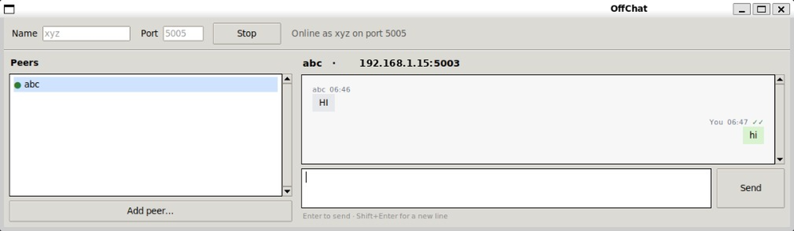

```
                            ___  _____ _____ ____ _   _    _  _____
                           / _ \|  ___|  ___/ ___| | | |  / \|_   _|
                          | | | | |_  | |_ | |   | |_| | / _ \ | |
                          | |_| |  _| |  _|| |___|  _  |/ ___ \| |
                           \___/|_|   |_|   \____|_| |_/_/   \_\_|

```


---

## What is OffChat?

OffChat is a small LAN chat project I'm building with C and Python. The idea is simple: find other OffChat users on the same network and send messages without needing the internet.

I started this for my college work, but I couldn't finish everything I had planned in the time I had. There's still plenty to improve, so I'm making the project open to contributions.

I'm learning open source too. If you're new to it, you're welcome to pick an issue, try something, and learn along the way.

**Current status:** It currently targets LAN use, and some features still need testing and improvement.

---

## Screenshot




## How it works

```text
             OFFCHAT ARCHITECTURE

┌──────────────────────┐                          ┌──────────────────────┐
│                      |                          │                      │
│      Frontend        │      stdin / stdout      │       Backend        │
│       gui.py         │ ◄──────────────────────► │      Networking      │
│   Python + Tkinter   │                          │      C language      │
│                      │                          │                      │
└──────────────────────┘                          └──────────┬───────────┘
                                                             │
                                              ┌──────────────┴──────────────┐
                                              │                             │
                                         UDP Broadcast                  TCP Socket
                                        Peer Discovery                 Chat Messages
                                              │                             │
                                              └──────────────┬──────────────┘
                                                             │
                                                  ┌──────────▼───────────┐
                                                  │   Other OffChat      │
                                                  │   Devices on LAN     │
                                                  └──────────────────────┘
```

- **UDP broadcast** is used to look for other OffChat devices.
- **TCP** carries chat messages between devices.
- The Python GUI provides the chat window, while the C program handles networking.

## Project structure

```text
offchat/
├── Backend/
│   ├── include/
│   │   ├── discovery.h
│   │   ├── message.h
│   │   ├── network.h
│   │   └── protocol.h
│   └── src/
│       ├── discovery.c
│       ├── main.c
│       ├── message.c
│       ├── network.c
│       └── protocol.c
└── Frontend/
    └── gui.py
```

| File | Purpose |
|:--|:--|
| `discovery.c` | Finds other OffChat devices using UDP broadcast. |
| `network.c` | Handles TCP sockets. |
| `message.c` | Creates and validates messages and contains message ,ACK info. |
| `protocol.c` | Handles packet headers and message framing. |
| `main.c` | Runs the C backend. |
| `gui.py` | Provides the Tkinter interface. |

## Run it locally

These steps are for Linux or WSL.

### 1. Install the dependencies

```bash
sudo apt update
sudo apt install build-essential python3 python3-tk
```

### 2. Build the backend

From the repository root:

```bash
cd Backend
gcc -Wall -Wextra -pthread -Iinclude src/main.c src/discovery.c src/message.c src/network.c -o offchat
```

### 3. Start the GUI

```bash
cd ../Frontend
python3 gui.py --name XYZ --port 5000
```

Available options:

| Option | What it does | Default |
|:--|:--|:--|
| `--name` | Name other users see                          | Your login name |
| `--port` | TCP port to listen on                         | `5000` |
| `--peers` | Manually add a peer's name, IP address, and port. | When the peer isn't discovered automatically |
### 4. Test with another device

1. Start OffChat on two devices connected to the same network.
2. Wait for the other device to show up in **Peers**.
3. Select the peer and send a message.
4. To test on one computer, open two terminals and use different names and ports, such as `5000` and `5001`.

The GUI uses these delivery marks:

|     Mark     |     Meaning      |
|:------------:|:----------------:|
|     `…`      |     Sending      |
|     `✓`      |       Sent       |
|     `✓✓`     |    Delivered     |
| `✗ failed`   |  Failed to send  |

 ⚠️ Message delivery status is still a work in progress and may not work reliably.

## A few things to know

- OffChat is still a work in progress.
- It's currently work on LAN network only.
- Messages are **not encrypted**.

---


```text
                                     𝙱𝚞𝚒𝚕𝚝 𝚠𝚒𝚝𝚑 𝙲 & 𝙿𝚢𝚝𝚑𝚘𝚗.
```